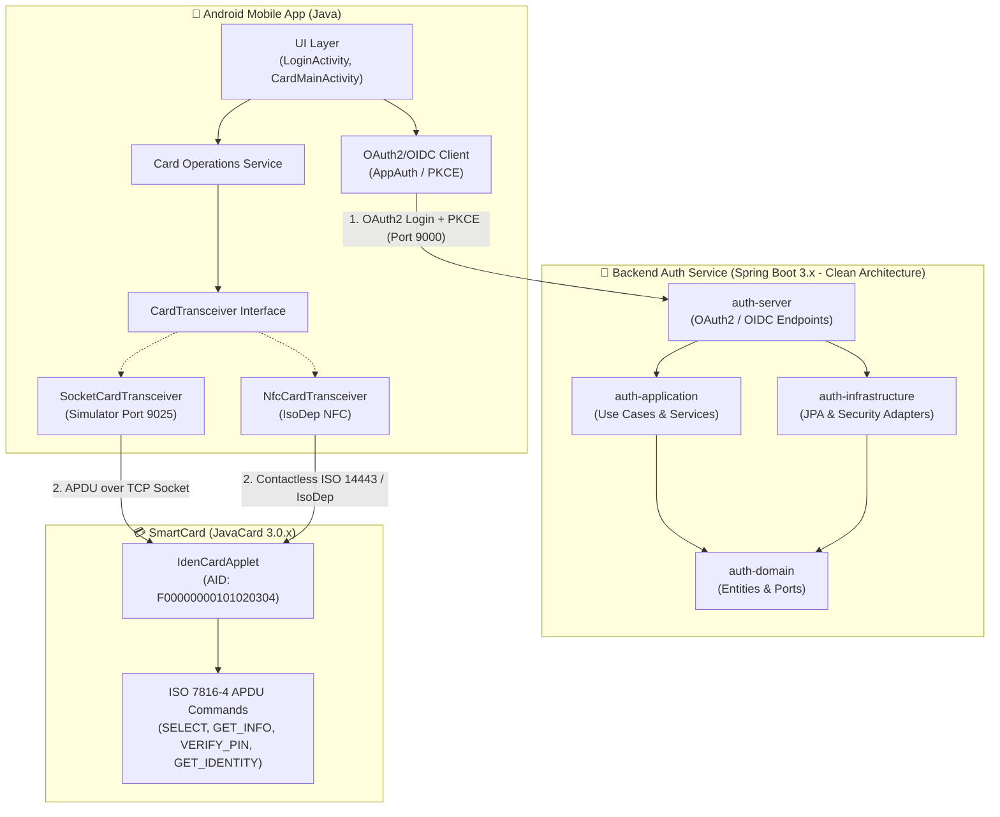

# 💳 IdenCard — Hệ Thống Định Danh Thẻ Thông Minh & SSO

> **IdenCard** là giải pháp định danh và xác thực toàn diện kết hợp giữa hệ thống **SSO (Spring Boot OAuth2 / OpenID Connect)**, ứng dụng di động **Android (Java)** và ứng dụng thẻ chip **JavaCard Applet**.

---

## 🏗️ Kiến Trúc Hệ Thống (Architecture)



---

## 📂 Cấu Trúc Thư Mục (Codebase Layout)

```text
payment/
├── pom.xml                                  # Root Maven Parent POM
├── shared/                                  # Module dùng chung (Maven)
│   ├── pom.xml
│   └── common-protocol/                     # APDU Command/Response, CLA/INS/SW status codes
├── backend/                                 # Auth Service theo Clean Architecture (Maven)
│   ├── pom.xml
│   ├── auth-domain/                         # Pure Java Domain (User, ClientApp, Ports, Exceptions)
│   ├── auth-application/                    # Application Use Cases & CQRS DTOs
│   ├── auth-infrastructure/                 # JPA Repositories, Database Entities & Security Adapters
│   └── auth-server/                         # Spring Boot 3.x, Spring Authorization Server, Endpoints
├── smartcard/                               # JavaCard Applet (Ant-JavaCard)
│   ├── pom.xml                              # Maven Wrapper & integration
│   ├── build.xml                            # Ant script sinh file .cap chuẩn
│   └── src/main/java/com/idencard/applet/   # Source code IdenCardApplet.java
└── android-app/                             # Android App (Gradle tiêu chuẩn, viết bằng Java)
    ├── build.gradle / settings.gradle
    └── app/                                 # Mã nguồn Android (OIDC PKCE, CardTransceiver, UI)
```

---

## 🚀 Hướng Dẫn Cài Đặt & Khởi Chạy

### 1. Yêu cầu môi trường
* **JDK 21 LTS**
* **Apache Maven 3.8+**
* **Android Studio Ladybug (hoặc mới hơn) với Android SDK 34**
* *(Tùy chọn cho thẻ chip)*: Oracle JavaCard SDK (3.0.4/3.0.5) và GlobalPlatformPro (`gp.jar`)

---

### 2. Khởi chạy Backend Auth Service (SSO)
Từ thư mục gốc dự án:

```bash
# Biên dịch toàn bộ các module Maven
mvn clean install -DskipTests

# Khởi chạy Auth Server (cổng 9000)
cd backend/auth-server
mvn spring-boot:run
```

* **SSO Discovery Endpoint:** `http://localhost:9000/.well-known/openid-configuration`
* **OAuth2 Authorize Endpoint:** `http://localhost:9000/oauth2/authorize`
* **OAuth2 Token Endpoint:** `http://localhost:9000/oauth2/token`
* **H2 Console:** `http://localhost:9000/h2-console` (JDBC URL: `jdbc:h2:mem:idencard_auth`)
* **Tài khoản mặc định sẵn sàng:**
  * Admin: `admin` / `admin123`
  * Cardholder: `cardholder` / `card123`
  * OAuth2 Client ID: `idencard-android` (Hỗ trợ PKCE, không cần client_secret)

---

### 3. Biên dịch JavaCard Applet sinh file `.cap`

```bash
cd smartcard

# Thiết lập biến môi trường trỏ đến JavaCard SDK
export JC_HOME=/path/to/java_card_kit-3_0_5-u4

# Biên dịch ra file .cap
ant build-cap

# (Nếu có thẻ vật lý và đầu đọc) Nạp trực tiếp lên thẻ:
ant deploy-gp
```

File đầu ra: `smartcard/target/cap/idencard.cap`

---

### 4. Mở và chạy Android App

1. Mở thư mục `android-app` bằng **Android Studio**.
2. Nhấn **Sync Project with Gradle Files**.
3. Chạy ứng dụng trên Android Emulator hoặc thiết bị thật.
4. **Luồng hoạt động trên App:**
   - **Bước 1 (Xác thực SSO):** Nhấn **"Đăng nhập qua SSO"** để thực hiện luồng Authorization Code + PKCE mở qua trình duyệt (hoặc nhấn **"Đăng nhập nhanh Demo"** để vào thẳng giao diện thẻ).
   - **Bước 2 (Kết nối thẻ):** Nhấn **"Kết nối Card Simulator (Socket)"** (hoặc chọn chế độ NFC).
   - **Bước 3 (Thao tác thẻ):** 
     - Nhấn `1. Đọc thông tin thẻ` để lấy số serial (`IC-2026-0001`) và số lần thử PIN còn lại.
     - Nhập mã PIN (mặc định: `1234`) và nhấn `2. Xác thực mã PIN`.
     - Nhấn `3. Truy xuất dữ liệu định danh` để nhận chuỗi định danh đã được mã hóa trong thẻ.

---

## 📡 Bảng Mã Lệnh APDU (Protocol Specification)

| Chỉ thị (INS) | Mã HEX | Ý nghĩa | Yêu cầu PIN |
|---|---|---|---|
| `INS_SELECT` | `0xA4` | Chọn Applet bằng AID (`F00000000101020304`) | Không |
| `INS_GET_CARD_INFO` | `0x10` | Lấy Serial thẻ và trạng thái khóa | Không |
| `INS_VERIFY_PIN` | `0x20` | Xác thực mã PIN cá nhân | Không |
| `INS_GET_IDENTITY` | `0x30` | Lấy dữ liệu định danh bảo mật | **Bắt buộc** |
| `INS_UPDATE_PIN` | `0x40` | Đổi mã PIN mới | **Bắt buộc** |
